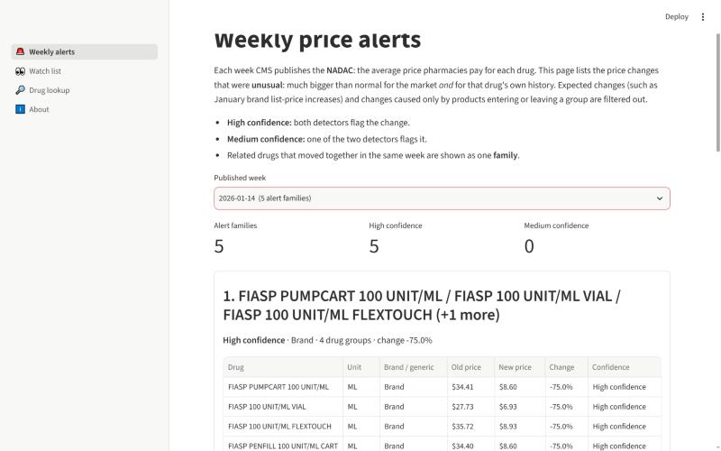
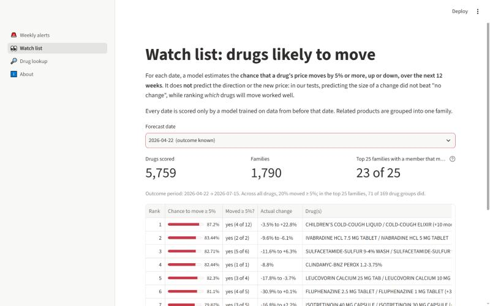
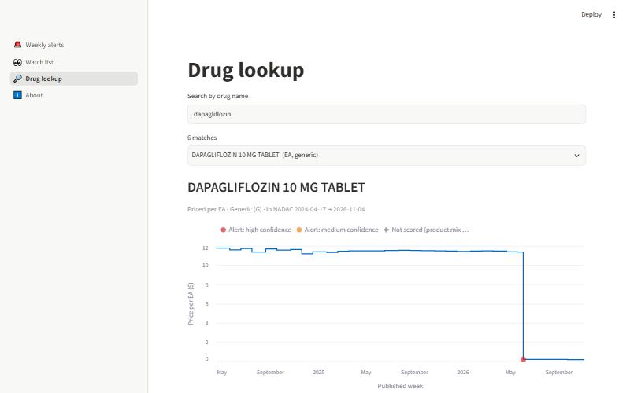
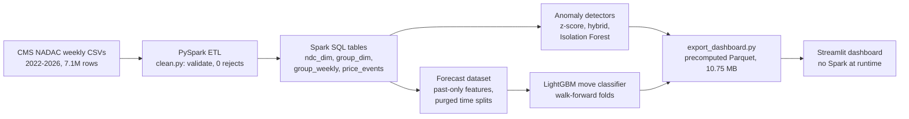

# Drug price anomaly detection and forecasting (CMS NADAC, 2022–2026)

Every week CMS publishes the **NADAC** (National Average Drug Acquisition Cost): what US retail pharmacies pay
for each drug package (42,542 NDCs over 2022–26). This project turns five years of those files into three tools:

- **Weekly price alerts:** which price changes this week were truly unusual. Big for the market *and* for that
  drug's own history, after filtering out expected events such as January brand list-price increases.
- **A "likely to move" watch list:** which drugs have a high chance of moving **≥ 5% (up or down)** in the next
  12 weeks.
- **A drug lookup:** each drug's price history with its alerts marked.

**Who would use it:**
- **State Medicaid programs:** NADAC-based reimbursement, spotting rate changes that need review.
- **Pharmacies and buying groups:** acquisition-cost surprises.
- **Pharma pricing and Value & Access teams:** monitoring competitor and generic-entry price moves, e.g. a
  generic launch collapsing a brand's class price.

**Live demo:** _coming soon (Streamlit Community Cloud)_ · Code: this repository

| Weekly alerts | Watch list | Drug lookup |
|---|---|---|
|  |  |  |

## Data

**Source and size:**
- **Source:** CMS NADAC weekly files, **2022-01-05 to 2026-11-04**, 253 consecutive weeks.
- **Size:** **7,127,017 rows** covering **42,542 NDCs**.

**Cleaning and validation (PySpark):**
- **Schema rules for every row:** types, dates, prices and codes. Failing rows go to a rejects folder with a
  reason, never silently dropped. **0 rows were rejected.**
- **Row counts reconcile at every step:** CSV = clean = weekly table = 7,127,017.
- **No calendar problems:** no missing weeks, no week appearing in two files, no non-Wednesday dates and no
  duplicate NDC-weeks.

**Drug groups:**
- **The key:** NDCs are grouped by *description + pricing unit + brand/generic class*, giving **7,594 groups**.
  A group's weekly price is the median of its NDCs.
- **Validation:** in 845,934 group-weeks with 2+ NDCs, all NDCs share one price **87.8%** of the time. That rises
  to **99.2%** once NDCs that CMS prices by package size (explanation code 5) are left out.

**Look-ahead bias, handled throughout:**
- **Future columns:** columns describing the future (`outcome_*`, `target_*`) are used only for evaluation.
- **Past-only features:** every feature uses only weeks published up to the decision date. This is proven with
  provenance checks, plus *truncation tests* that recompute features after deleting all later data. Result:
  **0 mismatches**, for example on 4,400 recomputed values.
- **Time splits:** splits are time-based and *purged*, so no training target window overlaps the test period.

## Pipeline



## 1. Anomaly detection

**No labelled anomalies exist**, so detectors are graded on proxy labels on the 2025–26 test period:
- **Positives:** big moves that persisted, and moves ≥ 5× the drug's own 95th-percentile past move.
- **Negatives that must *not* be flagged:** January brand list-price increases and normal moves.
- **Named test cases (14):** known events, such as isosorbide, prucalopride and phenobarbital flips (should be
  flagged), and Otezla's January increases (should not be).

| Detector (test 2025–26, single events) | Big lasting moves found in top 100 | Drug-unusual moves found in top 100 | Known anomalies in top 100 | Normal moves wrongly in top 1,000 | January list increases wrongly in top 1,000 | Named cases passed |
|---|---|---|---|---|---|---|
| Rank by size of change (baseline) | 1.0 | 0.5 | 0.76 | 0 | 0 | 14 / 14 |
| Robust z-score, seasonal | 0.662 | 0.8 | 0.83 | 158 | 7 | 7 / 14 |
| **Hybrid** (size + unusual for this drug) | 0.815 | 0.7 | 0.84 | 0 | 3 | 8 / 14 |
| **Isolation Forest, 3 features** | 0.846 | 0.744 | 0.88 | 245 | 12 | 14 / 14 |
| Isolation Forest, 13 features | 0.508 | 0.633 | 0.65 | 64 | 554 | 1 / 14 |
| **Final: hybrid + IF-small second opinion** | 0.815 | 0.7 | 0.84 | 0 | 3 | **14 / 14** |

**Why the ensemble won.**
- **The hybrid is the main score.** It is the only learned detector with **0 normal moves** in its top 1,000, and it
  is easy to explain ("bigger than 99.9% of past moves; very unusual for this drug").
- **Its blind spot:** large *repeated* swings (phenobarbital) look normal for that drug.
- **IF-small fills the gap.** It catches those swings but is noisy deeper down (245 normal moves in its top 1,000).
- **The combination:** an alert is **high confidence** when both detectors put it in their top 1%, and
  **medium** when one does. The combination passes all 14 named cases.

**Why the 13-feature Isolation Forest failed.**
- **It flags what is *rare*, not what is *suspicious*.** Context features make routine events look rare.
  - A brand price changing in January is an unusual combination.
  - CMS's list-price adjustment code appears on only 1.8% of training events.
- **Result:** 261 of its top 500 events are January list increases. Context belongs in explanations and caution
  flags, not in the score.

**Final alert list (2025–26):**

| | Value |
|---|---|
| Alerts | **176**: 129 high, 47 medium |
| Known false alarms | **0**: no known negative, hard or easy, is alerted |
| High-confidence alerts that are known anomalies | **76%** (98 of 129); the other 31 are unlabelled or unclear |
| Recall | 64 of 65 big lasting moves; 75 of 90 drug-unusual moves |
| Analyst workload | median **0** alert families per week, mean 1.33, max 13; 51 of 84 weeks have no alert |

**Manual review and artefacts found.** The top-20 flags were reviewed by hand:
- **Confirmed as real market events** (owner's external check): the generic launches of dapagliflozin and
  dapagliflozin-metformin (−98% and −92/−93%), and an isoniazid manufacturer change (+1,451%).
- **Investigated with NDC-level data, two were artefacts:**
  - **Dilantin +957%:** new NDCs were temporarily classified generic, then reclassified. The original NDCs'
    price never moved.
  - **Sodium chloride:** a package-size mix change.
- **What the review led to:** a data-driven `artefact_suspect` rule (the group moves ≥ 30% while the NDCs present
  in both weeks move < 5%). It excludes 37 of 1,206 big moves. Caution flags are shown on alerts for
  classification changes, data gaps and mix-driven moves.

Details: [anomaly summary](reports/anomaly_detection_summary.md) · [top-20 review](reports/top20_review.md) ·
[sample alerts](reports/sample_alerts.md)

## 2. Forecasting (12 weeks ahead)

**Predicting the size of the change didn't beat "no change".** The target was the 12-week log price change,
backtested over 4 purged walk-forward folds in 2025–26. Skill = 1 − MAE / MAE of "no change".

| Model | Skill, all | Generic | Brand |
|---|---|---|---|
| Predict no change | 0 (MAE 0.0464) | 0 | 0 |
| Drift (last 12 weeks continue) | −0.1860 | −0.1572 | −0.6295 |
| Seasonal (brands: copy past January change) | −0.0093 | 0.0000 | −0.1523 |
| LightGBM (L1) | −0.2163 | −0.2151 | −0.2347 |
| LightGBM, recent window + shrinkage (follow-up) | −0.1676 | −0.1740 | −0.0687 |

**Why it lost:**
- **2024 had market-wide swings.** The mean 12-week log change after the 2024-01-31 and 2024-02-28 origins was −0.104 and −0.122.
  The model learned "February → big drop".
- **2025–26 was calm.** Generics moved about half as much: "no change" MAE was 0.110 on train vs 0.061 on test.
- **Brands started drifting by tiny amounts.** Exactly-zero changes fell from 48% of rows to 20%.

**Predicting *whether* it moves ≥ 5% works.**
- **What it says:** a LightGBM classifier gives each drug a *chance of moving ≥ 5% (up or down)*. It never claims a
  direction.
- **How it was tested:** 4 walk-forward folds, all settings chosen on validation slices only.

| 2025–26, pooled | Ranking quality (ROC AUC) | Share of top 500 that moved | Base rate |
|---|---|---|---|
| Rank by recent volatility | 0.778 | 0.456 | 0.287 |
| **Classifier + competition features** | **0.816** | **0.744** | 0.287 |
| Brands only | 0.847 (volatility rule: 0.488) | 0.432 | 0.043 |

**Per fold:**
- **ROC AUC:** 0.802–0.836.
- **Top 100:** **62–86%** of the drugs really moved, against base rates of 25–32%.

**Competition features: a real signal, a marginal gain.**
- **The features:** labeler counts, entries and exits, from the NDC labeler code.
- **The signal is real in the raw data.** A new labeler goes with more price drops: in training, 39.6% of generic
  rows fell ≥ 5% after a labeler entry, vs 30.4% without one.
- **The gain is small:** generic ROC AUC 0.727 → 0.729, and generic share of top 500 that moved 0.730 → 0.744. The
  model already captured most of it through volatility and product counts.

Details: [setup](reports/forecast_setup.md) · [regression](reports/forecast_results.md) ·
[classifier](reports/forecast_followups.md) · [competition](reports/forecast_competition.md)

## Limitations and next steps

**Limitations:**
- **Proxy labels.** There's no ground truth for "anomaly". Labels partly use future prices, so alerts still need
  human review.
- **A calm test period.** 2025–26 moved about half as much as 2022–24. Models trained on the 2024 swings are
  over-confident at first.
- **Labeler ≠ manufacturer.** The labeler code can be a repackager or store brand, so competitor counts are
  approximate.
- **NADAC only.** NADAC covers surveyed retail pharmacy acquisition costs, not WAC, net or 340B prices.

**Next steps:**
- FDA **drug shortage** data and **ANDA approval / first-generic** dates as leading features for generic-entry drops.
- WAC list-price feeds to separate list-price actions from market moves.
- Recalibrating watch-list probabilities on recent data.

## How to run

**Requirements:** Python 3.12 and Java 21. On Windows, also `winutils` / `hadoop.dll` in `%HADOOP_HOME%\bin`.

```bash
pip install -r requirements.txt
```

**Pipeline, in order** (Spark steps write to `data/`, which is not committed):

```bash
python download.py 2022 2023 2024 2025 2026   # medicaid.gov may block non-US/Canada IPs
python clean.py 2022 2023 2024 2025 2026
python build_tables.py
python anomaly_eval.py
python detect_zscore.py
python detect_hybrid.py
python detect_iforest.py
python detect_final.py
python evaluate.py
python forecast_setup.py
python competition_features.py
python forecast_models.py
python forecast_followups.py
python forecast_competition.py
python export_dashboard.py
```

**Dashboard** (reads only the committed `dashboard_data/`, so it runs without the pipeline):

```bash
pip install -r dashboard/requirements.txt
streamlit run dashboard/app.py
```

Built step by step with PySpark 4.3, Spark SQL, scikit-learn, LightGBM and Streamlit. Data: CMS NADAC (public).
