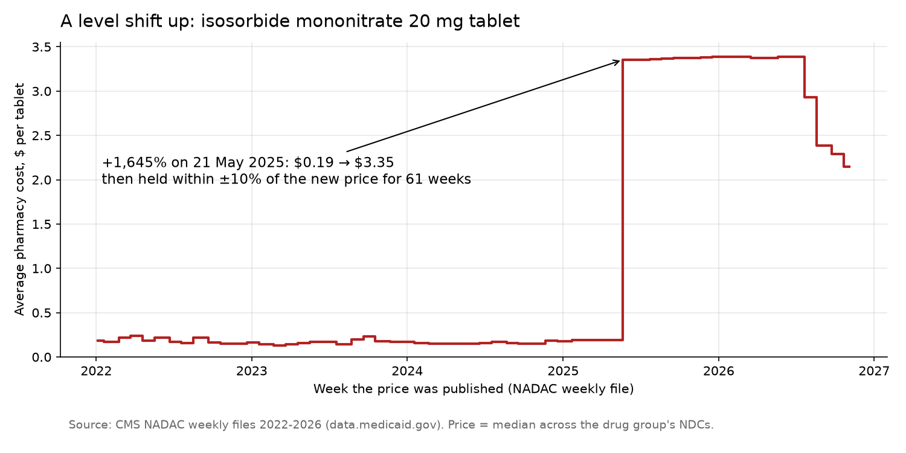
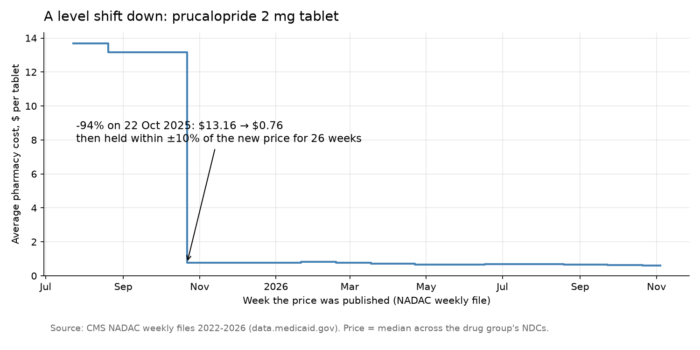
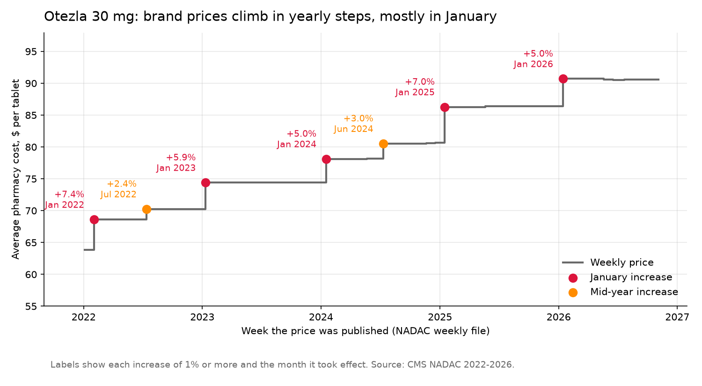
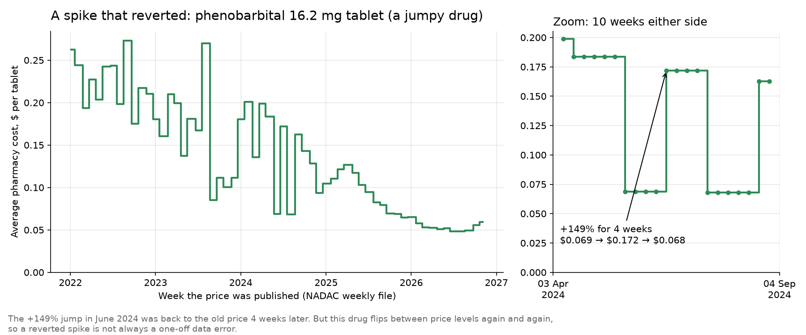
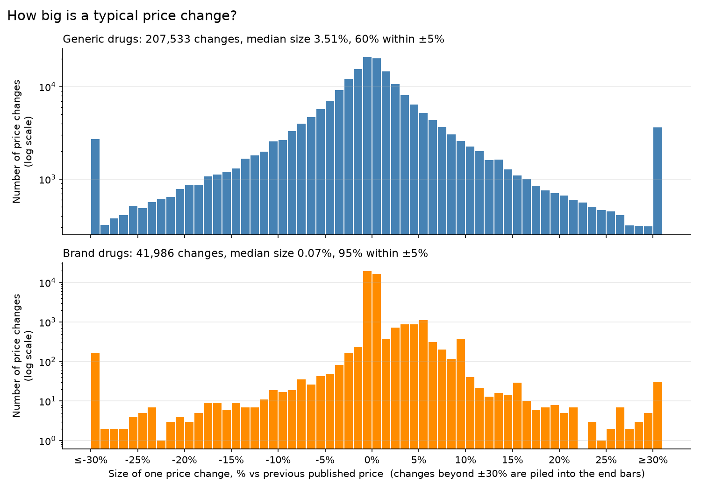
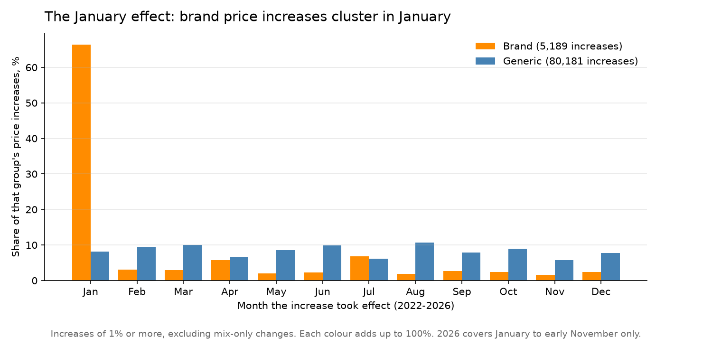

# Day 1 data report: NADAC drug prices 2022–2026

*Generated by `make_report.py` on 12 November 2026. Every number below is computed from the project's
tables (`data/clean/nadac`, `data/tables/`); the raw values are in `reports/day1_numbers.json`.*

## 1. The data

**Source.** CMS's *National Average Drug Acquisition Cost* (NADAC): the average price retail pharmacies pay to
buy a drug, from a monthly invoice survey, republished every week. One CSV per year from data.medicaid.gov
(dataset IDs listed in `download.py`).

| | |
|---|---|
| Years | 2022–2026 (2026 is partial: up to 04 Nov 2026) |
| Rows (one NDC in one weekly file) | 7,127,017 (2022: 1,315,703 · 2023: 1,376,395 · 2024: 1,497,925 · 2025: 1,608,416 · 2026: 1,328,578) |
| NDCs (individual product packages) | 42,542 |
| Drug groups ("same product, priced together") | 7,594 |
| Weeks | 253 (every Wednesday from 05 Jan 2022 to 04 Nov 2026) |
| Group-week rows / price-change events | 1,394,111 / 249,898 |

**Cleaning.** Every file is read as text first (so 11-digit NDCs keep their leading zeros), then typed with
"try" conversions and checked against 12 rules (valid NDC, price > 0, real dates, known codes, week inside its
year...). Failing rows would go to a rejects folder with a reason instead of being dropped: **0 rows were
rejected** out of 7,127,017. Two format differences between years were fixed in the cleaning code: 2022–2023
column names use underscores, and one 2022 week is written `1/12/2022` instead of `01/12/2022`.

## 2. Can we trust it?

**Checks that passed**

- **Complete timeline:** 253 weekly files, 0 gaps, 0 weeks appearing in two yearly files, 0 dates that are not a Wednesday.
- **No duplicates:** 0 repeated (NDC, week) pairs across all years.
- **Rows reconcile at every step:** 7,127,017 rows in the CSVs = 7,127,017 clean rows = 7,127,017 rows counted in the weekly group table.
- **The drug-group key works:** in 845,934 group-weeks with 2+ NDCs, all NDCs share one identical price 87.8% of the time, and 99.2% once we leave out NDCs that CMS prices by package size (explanation code 5, 19% of rows).
- **Reworded names don't break histories:** 296 NDCs had their description reworded by CMS (e.g. `TESTOSTERON` → `TESTOSTERONE`); each NDC is filed under its most recent name, so it keeps one continuous history.

**Known limitations**

- **Price tiers:** in 7.4% of group-weeks, the group has more than one price (mostly package sizes). We use the median NDC price, which is always a real price, but it can move when the NDC mix changes.
- **Mix-only moves:** 379 events (0.2%) changed the median only because NDCs entered or left the group. Rare overall, but 59 of the 1,265 moves larger than 50%. They are flagged, not deleted.
- **Gaps:** 764 events (0.3%) come right after weeks where the group was missing, so their exact timing is uncertain (flagged `after_gap`).
- **Backdating:** 98.2% of changes take effect the week they are published, but brand list-price increases are usually published later (75% backdated, median 7 days). The 76 "lags" over 90 days are not backdating: 69 of them are carried-forward package-size prices (codes 4 + 5).
- **2026 is partial,** and the newest events have no "what happened next" yet.

## 3. How prices behave

- **Generics move often, in small steps.** 207,533 changes across 5,141 groups, typically every 4 weeks (CMS's monthly survey). The median change is 3.51%, 60% are within ±5%, and they go up and down about equally (48% up). Overall, 18% of group-weeks show a change. *(Chart e)*
- **Brands are flat, then step up in January.** Brand changes are tiny (median 0.07%), but of the 5,189 brand increases of 1% or more, **66% took effect in January**, against 8% for generics. Otezla 30 mg is a textbook case: +7.4% (Jan 2022), +2.4% (Jul 2022), +5.9% (Jan 2023), +5.0% (Jan 2024), +3.0% (Jun 2024), +7.0% (Jan 2025), +5.0% (Jan 2026). *(Charts c, f)*
- **Big moves are rare, and the clear ones stick.** 1,206 real moves exceeded ±50%. Only **24** returned to the old price within 4 weeks (like phenobarbital, chart d, although that drug flips between price levels repeatedly, so a reversal is not always a one-off error). Eight weeks later, 870 of the 1,192 with an 8-week price were still closer to the new level than the old one: level shifts such as isosorbide mononitrate (chart a, held for 61 weeks before easing) and prucalopride (chart b). Our strict "within ±2% of the new price" test confirms only 337, because generic prices keep drifting month to month.

## 4. What this means for Day 2

- **Define an anomaly relative to the drug's own normal.** A 5% move is routine for a generic and unusual for a brand outside January. Judge each change against its group's history and class, and treat January brand increases as expected events.
- **Separate two kinds of anomaly:** level shifts (a new price that sticks, the common big event) and spikes that revert (rare; some may be data blips, others are drugs that genuinely jump back and forth). They need different detectors and different actions.
- **Model drug groups, not NDCs.** Many NDCs share one price; per-NDC models would count one event dozens of times.
- **Use only what was known at the time:** order everything by the *published* week, never the effective date (it can be backdated), so no model peeks ahead.
- **Skip `mix_only` events by default and handle `after_gap` with care.**
- **Outcome columns are for evaluation only.** `outcome_*` in `price_events` describes the future; it is how we will score detectors, never an input to them.
